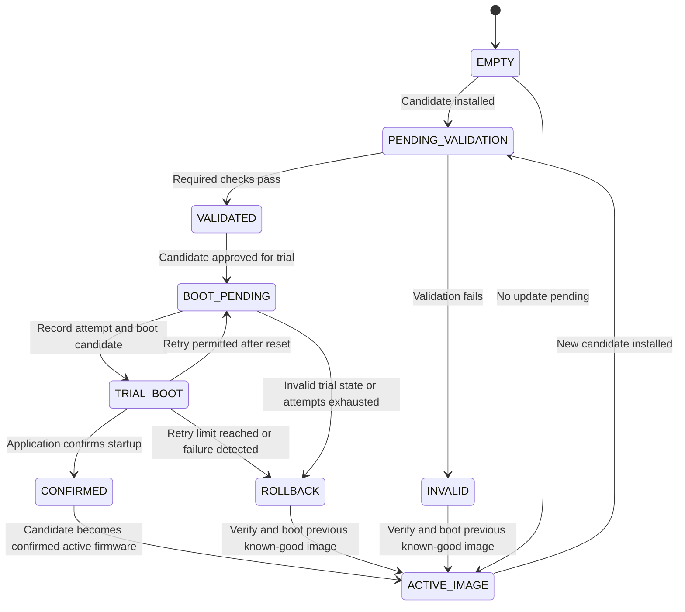

# Persistent FOTA Update State Machine

## 1. Purpose

This document defines the planned persistent update-state mechanism for the future production-oriented FOTA enhancement of the STM32F407 Secure Boot project.

The current implementation supports firmware metadata validation, SHA-256 integrity verification, candidate/active image management, candidate rejection, active-image fallback, and fail-safe handling. It does not yet implement the persistent trial-boot, confirmation, and rollback state machine described here.

The state machine will be developed as a separate enhancement, following digital signature authentication and candidate-to-active activation design.

Its purpose is to track firmware update progress across resets, manage candidate firmware trial execution, record application confirmation, and recover to a verified known-good firmware image when an update fails.

## 2. Candidate Update State Machine



The final implementation must define retry limits, reset detection, confirmation deadlines, and the conditions that cause rollback. The diagram represents the planned behavior rather than implemented functionality.

## 3. State Definitions

| State | Meaning |
|---|---|
| `EMPTY` | No candidate update is pending |
| `PENDING_VALIDATION` | A candidate image has been installed and awaits validation |
| `VALIDATED` | The candidate has passed the required integrity and, when implemented, authenticity checks |
| `BOOT_PENDING` | The candidate is approved for trial execution |
| `TRIAL_BOOT` | The candidate is executing provisionally and has not yet been confirmed |
| `CONFIRMED` | The application has successfully confirmed startup and the confirmation has been persisted |
| `ROLLBACK` | The candidate has failed the defined trial-boot policy, and recovery to the previous image is required |
| `INVALID` | Persistent update metadata or state is invalid or inconsistent |
| `ACTIVE_IMAGE` | The verified firmware image selected for normal execution; during a trial this remains the previous known-good image |

## 4. Main Update Flow

The planned update lifecycle is:

```text
EMPTY
  |
  v
PENDING_VALIDATION
  |
  v
VALIDATED
  |
  v
BOOT_PENDING
  |
  v
TRIAL_BOOT
  |
  v
Application Confirmation
  |
  v
CONFIRMED
  |
  v
Confirmed Active Firmware
```

Before trial execution, the bootloader must persist the trial state and attempt information so that a reset does not accidentally turn an unconfirmed candidate into a confirmed image.

## 5. Candidate Boot Failure and Rollback

```text
BOOT_PENDING
     |
     v
TRIAL_BOOT
     |
     v
Reset / Timeout / Startup Failure
     |
     v
Evaluate Retry Policy
     |
     +---- Retry permitted ----> BOOT_PENDING
     |
     +---- Retry exhausted ----> ROLLBACK
                                      |
                                      v
                            Verify Previous Image
                                      |
                                      v
                               ACTIVE_IMAGE
```

A reset is not automatically proof of firmware failure. The bootloader will evaluate the persistent trial state and boot-attempt policy to determine whether another trial is permitted or rollback is required.

The previous known-good image must remain intact until the candidate is successfully confirmed. Before booting it, the bootloader must verify its metadata, memory boundaries, and firmware integrity.

## 6. Candidate Confirmation

After successful startup, the application will explicitly request confirmation through a defined bootloader/application interface.

The bootloader or trusted update-management component will validate the confirmation request and persist the confirmed state.

The design must address:

- Confirmation-interface validation
- Persistent confirmation recording
- Reset or power loss during confirmation
- Duplicate or stale confirmation requests
- Consistency between image metadata and update state

The exact confirmation mechanism will be determined during implementation.

## 7. Invalid State and Recovery Handling

An invalid, corrupted, or inconsistent persistent state must never authorize execution of an unverified firmware image.

The bootloader will attempt to identify and verify the previous known-good image. If that image is unavailable or fails validation, the system must enter a defined fail-safe or recovery path rather than blindly executing it.

Persistent state integrity, interrupted Flash writes, and recovery behavior will be addressed during implementation and fault-injection testing.

## 8. Persistent Storage Design

A dedicated non-volatile storage arrangement will be defined for update-state information.

The proposed record may include:

- Update-state identifier
- Candidate image identifier and location
- Firmware version
- Candidate image size and integrity reference
- Boot-attempt counter
- Confirmation status
- Record sequence number
- Record validity or commit marker

Storage allocation, record format, atomic update strategy, wear management, and corruption recovery will be finalized during the implementation phase.

Persistent state must not be treated as trustworthy merely because it survives a reset. Records must be checked for validity and consistency with the corresponding firmware metadata.

## 9. Design Considerations

The future implementation will address:

- Trial boot of candidate firmware
- Explicit application confirmation
- State persistence across reset and power loss
- Bounded boot attempts
- Automatic rollback to a verified known-good image
- Recovery from interrupted updates
- Consistent firmware and update-state metadata
- Authenticated firmware activation after signature verification is implemented
- Anti-rollback policy and version enforcement
- Flash-write integrity and atomic state transitions

The previous known-good firmware will be preserved until the candidate is confirmed. Update-state transitions must be designed to avoid leaving the system without a bootable, verified recovery image.

## 10. Implementation Status

**Status: Planned Future Enhancement — Design Specification**

This document describes the intended persistent FOTA state machine. It is not evidence that persistent trial-boot management, application confirmation, candidate-to-active activation, automatic rollback, or power-loss recovery has already been implemented.

These capabilities will be developed and verified as part of the future production-oriented FOTA enhancement. Digital signature authentication remains a separate planned security enhancement.
